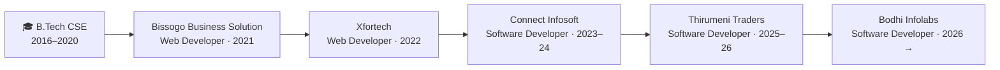

<!-- Replace YOUR_LINKEDIN with your LinkedIn profile ID -->

<h1 align="center">Hey, I'm Ramprasan R P 👋</h1>
<h3 align="center">Full Stack Software Developer | Laravel • React • MySQL</h3>

<p align="center">
  <a href="https://git.io/typing-svg">
    
  </a>
</p>

<p align="center">
  <a href="https://linkedin.com/in/YOUR_LINKEDIN"></a>
  <a href="mailto:rramprasan07@gmail.com"></a>
  <a href="https://github.com/rramprasan"></a>
  
</p>

---

## 🧑‍💻 About Me

```php
<?php

class Ramprasan extends Developer
{
    public string $role     = 'Software Developer @ Bodhi Infolabs';
    public string $location = 'Trivandrum, Kerala, India';
    public string $degree   = 'B.Tech CSE — Mohandas College of Engineering and Technology';

    public array $backend  = ['Laravel', 'Livewire', 'CodeIgniter', 'Node.js', 'REST APIs'];
    public array $frontend = ['React', 'Inertia.js', 'Vue.js', 'AngularJS', 'Tailwind CSS'];
    public array $desktop  = ['Electron', 'SQLite (offline-first)'];

    public function focus(): string
    {
        return 'Clean, secure and scalable apps — and turning legacy code into modern Laravel.';
    }
}
```

## 🚀 Featured Work

| Project | What I did | Tech |
|---|---|---|
| 🏫 **School ERP** | Enterprise ERP with 25+ modules (admissions, attendance, fees, payroll, transport). Built teacher attendance with geofencing, punch-in/out rules and approval workflows | Laravel 12, React 18, Inertia.js, Spatie RBAC, Reverb, FCM |
| 📦 **Sales Distribution Platform** — Thirumeni Traders | Full-stack app for orders, inventory, customers and reporting | React, Laravel, MySQL |
| 🖥️ **Offline Desktop Apps** | Windows desktop apps that work fully offline | Electron, Vue.js, Node.js, SQLite / MongoDB |
| 🚗 **Vehicle Insurance Portal** | Built from scratch, integrating multiple insurance providers | Laravel, MySQL |
| 🔄 **Legacy Migrations** | Core PHP → Laravel and Python → Laravel rewrites for better structure, security and performance | Laravel |
| 📈 **Sales Automation** — HLL Lifecare Ltd. | Digitised manual sales processes | Laravel, MySQL, Bootstrap |

## 🛠️ Tech Stack

<table>
  <tr>
    <td align="center" width="140"><b>Backend</b></td>
    <td></td>
  </tr>
  <tr>
    <td align="center"><b>Frontend</b></td>
    <td></td>
  </tr>
  <tr>
    <td align="center"><b>Database</b></td>
    <td></td>
  </tr>
  <tr>
    <td align="center"><b>Desktop &amp; Tools</b></td>
    <td></td>
  </tr>
  <tr>
    <td align="center"><b>Laravel Ecosystem</b></td>
    <td>
      
      
      
      
      
    </td>
  </tr>
</table>

**What I bring:**

- ✅ RESTful API design & third-party API integration
- ✅ Role-based access control, real-time features (Reverb) & push notifications (FCM)
- ✅ Legacy modernisation — Core PHP / Python → Laravel
- ✅ Offline-first desktop apps with Electron + SQLite

## 📈 Professional Journey



## 📊 GitHub Stats

<p align="center">
  
  
</p>
<p align="center">
  
</p>
<p align="center">
  
</p>

## 🤝 Let's Connect

Always happy to talk about Laravel, React, or interesting projects — reach out at **rramprasan07@gmail.com** 📬
